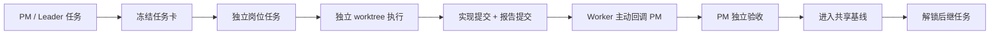
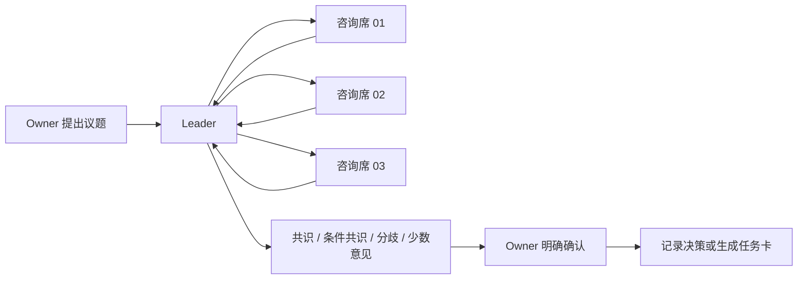

# AgentDesk 产品概览

> 本页“当前已实现”指下一版本候选源码。已发布的 `v0.1.0-beta` 是不含版本锁和
> 圆桌咨询的旧版基线；候选源码必须先构建为可验证只读发布包，才能获得项目写权限。

## 一句话定位

AgentDesk 是一套任务卡驱动的多 Agent 软件项目协作协议和 Codex Skill。它把“一个主会话包办全部工作”改造成可观察、可验收、可恢复的多岗位开发流程。

它关注的不是让 Agent 写更多代码，而是让以下事实可以被证明：

- 谁负责这张任务卡；
- 它依据哪个版本和哪个 Git 基线执行；
- 工作是否真的派发到了独立岗位任务；
- Worker 是否主动回调了 Leader；
- Leader 审查的是哪一个不可变提交；
- 通过验收的成果是否已经进入共享基线；
- 会话丢失或状态冲突后能否恢复。

## 核心闭环

这个闭环有三个不能替换的现实动作：

1. 真实创建或复用独立岗位任务；
2. 真实把派卡消息发送到该任务；
3. Worker 完成后真实向来源 Leader 任务发送回调。

工作树、Markdown 记录、逻辑角色或在主会话里切换人格，都不能代替这三个动作。

## 执行前的可选咨询层

当需求方向仍有重要不确定性时，Leader 可以在任务卡之前组织一次 V1 咨询。它是只读 advisory workflow，不属于上面的执行闭环，也不改变 `tasks.yaml` 或 Active roles。

席位数可选 0–3：0 表示不召开圆桌，不创建咨询会话；真实召开时创建 1–3 个独立席位。第一轮各席独立作答，最多进行两轮，所有交流都经 Leader 中心辐射，咨询席之间不直接协商。Leader 不按票数裁决，而是保留前提、冲突和少数意见。

Owner 对咨询结论的确认只允许记录决策或生成任务卡。它不等于授权创建执行岗位会话、实施、合并、部署或发布。完整规则见[咨询与圆桌研讨](11-consultation-and-roundtables.md)。

## 核心思想

### 仓库记录事实，聊天只负责传输

聊天可能丢失、被归档或脱离上下文。AgentDesk 把规格、状态、报告、验收和 Git 提交保存到仓库，使新的 Leader 可以从仓库接管，而不依赖旧对话。

### 自动化协作，不自动化权力

系统可以帮助派卡、对账、校验和恢复，但产品决策、高风险批准、最终验收、合并和发布仍受明确门禁控制。

### 交付、验收、集成是三件事

Worker 说“完成”只代表产生了交付声明；PM 验收通过形成 `Accepted`；成果进入共享基线后才是 `Integrated`。默认只有 `Integrated` 才能解锁后继开发。

### 运行时信息与仓库真相分离

任务 ID、会话 ID、绝对 worktree 路径、回执和凭据保存在被 Git 忽略的 `.agentdesk/runtime/`。仓库只保留可迁移、可审计的逻辑身份和证据。

## 三种采用模式

| 模式 | 适用场景 | 宣称该级别必须满足的条件 |
| --- | --- | --- |
| Lite | 小项目、缺少跨任务工具、人工接力 | 任务卡、Git 证据、人工派发与验收；不宣称自动多任务闭环 |
| Standard | 中大型项目、多岗位并行 | 真实独立任务、精确命名、独立 worktree、派发/回调回执、验收与集成门禁 |
| Automated | Standard 已稳定运行后的高并发项目 | 在 Standard 基础上增加租约续期、重试、死信、孤儿检测、监控和恢复自动化 |

推荐先跑通 Standard，再考虑 Automated。工具条件不满足时应明确使用 Lite，而不是写入占位会话 ID 或假装已经闭环。

初始化命令中的 `--mode` 只写入采用级别等配置元数据，并选择相应的 lease 模式；它不会自动创建岗位任务、启动 dispatcher、续租服务或证明表中条件已经成立。

## 当前已实现的能力

- 幂等项目初始化器；
- 项目模板、角色配置、任务卡、交付报告与验收模板；
- 权威任务账本与生成式 `BOARD.md` / `STATUS.md`；
- 任务结构、Git 证据，以及已实现范围内的 dispatch event/outbox、模型快照、acceptance 和运行时回执校验；
- 厂商无关的岗位模型策略与确定性模型选择器；
- Codex 独立岗位任务的创建、命名、派发和回调适配协议；
- V1 执行前只读咨询的独立公开记录、运行时会话证据与生成式 `CONSULTATIONS.md` 视图；
- Lite、Standard、Automated 的成熟度定义；
- 常见故障的恢复手册。

## 当前没有提供的能力

- Skill 脚本不会自行启动模型或替代 Codex 运行时；
- 没有独立常驻的 dispatcher、heartbeat daemon 或死信服务；
- 当前 `BOARD.md` 是生成式快照，不是实时网页看板；
- 尚未内置 Claude Code、Gemini CLI、Cursor、OpenCode 等外部平台适配器；
- 校验器不能代替真实的会话读取、消息发送、代码审查和测试；
- 不会在未经单独授权时自动合并、部署、发布或操作生产环境。
- 平台不能仅凭咨询记录验证发言者在现实组织中的 Owner 身份或授权范围，也不能保证实际模型与建议模型一致；无法核验时必须明确披露。

## 适合与不适合

AgentDesk 适合任务多、岗位多、交付需要审查、对恢复能力有要求的 Git 项目。对于只有一次小改动、无需并行和审计的任务，Lite 或普通单会话开发通常更经济。

下一步阅读：[系统架构](02-architecture.md)。
