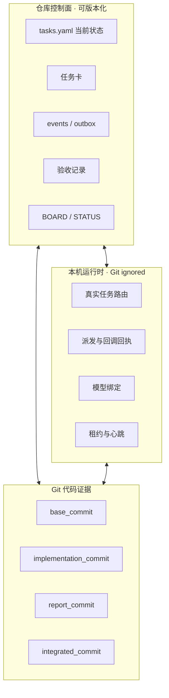
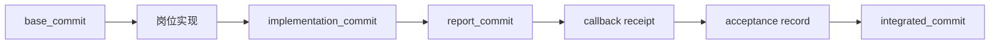

# AgentDesk 系统架构

## 三层结构

AgentDesk 把项目事实拆成仓库控制面、运行时和 Git 代码证据三层。



### 仓库控制面

它保存稳定、可审计、可迁移的事实：当前状态、冻结规格、派发意图、状态事件、交付报告和验收结论。

### 本机运行时

它保存容易变化或包含本机隐私的信息：真实 task/thread ID、绝对 worktree、provider 回执、租约和模型绑定。整个目录必须被 Git 忽略。

### Git 代码证据

分支只是发现入口，完整 commit SHA 才是验证对象。任务卡、实现、报告、验收和集成都绑定不可变提交。

## 权威顺序

| 顺序 | 载体 | 含义 |
| ---: | --- | --- |
| 1 | `docs/pm/state/tasks.yaml` | 当前编排状态的唯一权威 |
| 2 | `docs/pm/events/*.yaml` | 状态迁移、批准和撤销的审计记录 |
| 3 | `docs/pm/tasks/*.md` | 某一 revision 的工作规格 |
| 4 | `docs/pm/reports/*.md` | Worker 的交付声明和自检证据 |
| 5 | `docs/pm/acceptances/*.md` | PM 的审查证据 |
| 6 | `BOARD.md`、`STATUS.md` | 从账本生成的人类视图 |
| 7 | 聊天与通知 | 传输和提醒，不裁决状态 |

如果 `BOARD.md` 与 `tasks.yaml` 不一致，应重新生成看板，而不是手改看板。如果账本与 event 历史冲突，应冻结派发并进入恢复流程。

## 初始化后的项目结构

```text
AGENTS.md
docs/pm/
  state/tasks.yaml
  tasks/
  reports/
  acceptances/
  events/
  outbox/
  BOARD.md
  STATUS.md
  ROLES.md
  ROLE-POLICIES.yaml
  CHECKS.yaml
  DECISIONS.md
  PM-PLAYBOOK.md
.agentdesk/runtime/
  routes.yaml
  model-bindings.yaml
  pm-lease.yaml
  transport-receipts.yaml
  inbox/
```

`docs/pm/` 是项目协议和证据；`.agentdesk/runtime/` 是本机运行数据。两者不能混用。

## 一次派发的仓库事务

派发不是先发消息再补记录。正确顺序是：

1. 验证任务、依赖、岗位、模型、真实会话和 worktree；
2. 生成不可变 `dispatch_id`、event 和 outbox；
3. 将首次 `current_dispatch`、event、outbox、账本和视图作为同一个 Git commit 提交；
4. 运行 strict validator；
5. 将 outbox 内容发送到 verified 岗位任务；
6. 在运行时保存 transport receipt；
7. Worker 确认接单后再进入 `InProgress`。

这种“先提交意图，再执行传输”的方式允许进程在发送前崩溃后安全重放同一消息，而不创建第二个 attempt。

## 一个任务的证据链



实现与报告采用两个提交，避免报告记录包含自身的 SHA：先提交实现，再在其子提交中加入报告。PM 验收固定实现提交；随后再证明该实现已经进入目标基线。

## 写入权限

- 当前 PM lease holder：写账本、events、outbox、acceptances 和生成视图；
- Worker：写业务路径和本 attempt 唯一的 `report_path`；
- QA：在独立任务卡允许的范围内写测试与报告；
- Integration：只整合 PM 明确列出的 accepted commits；
- 其他会话：默认只读控制面。

这套权限边界是防止多会话同时修改状态、覆盖证据和“自己验收自己”的关键。

下一步阅读：[新项目快速开始](03-getting-started.md) 或 [既有项目接入](04-existing-project-adoption.md)。
