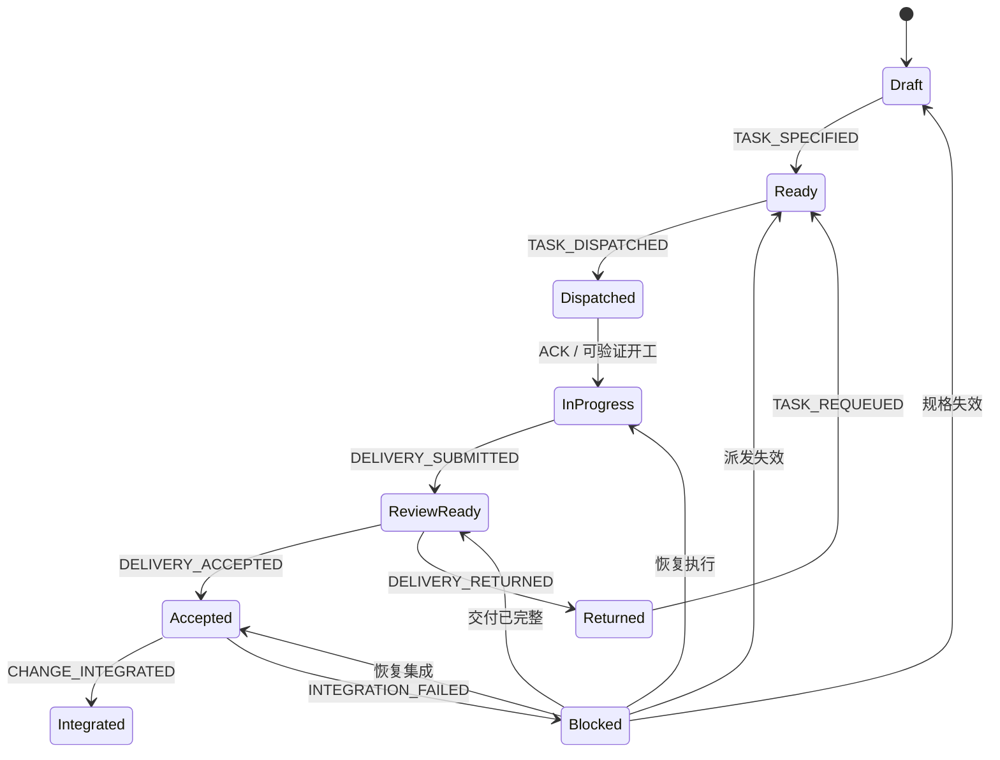

# 任务、状态与证据

AgentDesk 不使用一个模糊的“完成”字段描述所有事情。规格、执行、传输、交付、验收和集成分别有自己的标识和状态。

## 核心标识

| 标识 | 表示什么 | 什么时候变化 |
| --- | --- | --- |
| `task_id` | 一项稳定工作，例如 `TC-014` | 永不复用 |
| `revision` | 任务规格版本 | 目标、范围、依赖、基线或验收标准变化时递增 |
| `attempt` | 同一 revision 的一次执行 | 返工或执行重启时递增 |
| `dispatch_id` | 一次逻辑派发 | 新 attempt 时生成；传输重试不变 |
| `event_id` | 一次控制面状态事实 | 每次状态迁移、批准或撤销新增 |
| `message_id` | PM 的一条 outbox 消息 | 新出站事实时新增；重发不变 |
| `callback_id` | Worker 回调的幂等键 | 同一回调传输重试时不变；当前 beta 按 attempt 只安全使用一个不可变回调事实 |
| `base_commit` | 本次执行冻结的 Git 基线 | revision / attempt 规则决定，不使用移动分支代替 |

最小派发身份是：

```text
task_id + revision + attempt + dispatch_id + base_commit
```

## 任务状态机



本文使用 `InProgress`、`ReviewReady` 等 PascalCase 名称讲解概念；在 `tasks.yaml` 等机器可读文件中，对应值采用 snake_case，例如 `in_progress`、`review_ready`、`accepted` 和 `integrated`。具体序列化值始终以 Schema 为准。

当前 beta 对“缺少岗位任务创建授权时能否进入 Ready”存在规范不一致。本套文档遵循 `SKILL.md` 的保守执行方式：规格完整后可以保持 Ready 等待授权，但 `Ready → Dispatched` 前必须补齐授权、真实岗位任务、route 和 worktree；任何情况下都不得绕过派发门禁。

此外，非终态任务可以在有明确理由时进入 `Cancelled` 或被另一张卡 `Superseded`。

### 各状态的真实含义

| 状态 | 含义 |
| --- | --- |
| Draft | 规格还没有冻结 |
| Ready | 规格、依赖和门禁完整，可以准备派发 |
| Dispatched | 派发意图已原子提交，并准备或已经真实发送；不等于 Worker 接单 |
| InProgress | Worker 已 ACK，或有可验证开工证据 |
| ReviewReady | 双提交交付完整，等待 PM 审查 |
| Returned | 当前交付被拒绝，旧 attempt 已关闭 |
| Blocked | 存在明确阻塞、责任方、解除条件和恢复目标 |
| Accepted | PM 固定了通过审查的实现提交 |
| Integrated | 验收成果已进入目标共享基线 |
| Cancelled | 主动终止 |
| Superseded | 被新任务或新方向替代 |

禁止的捷径包括：

- `Draft → Dispatched`；
- `InProgress → Accepted`；
- `ReviewReady → Integrated`；
- heartbeat 直接推动业务状态；
- report 或聊天中的“完成”直接覆盖账本。

## 三个正交状态维度

### `task_state`

描述控制面流程走到哪里。

### `delivery_state`

描述当前 attempt 是否形成了可审查交付：

```text
none → working → submitted → accepted
                    ↘ invalid / rejected
```

### `integration_state`

描述成果相对目标基线的位置：

```text
not_applicable | pending | integrated | failed
```

典型代码任务在 `Accepted` 时通常仍是：

```yaml
delivery_state: accepted
integration_state: pending
```

只有共享基线包含成果后，任务才进入 `Integrated`。

## revision、attempt 与传输重试

| 场景 | 正确动作 |
| --- | --- |
| 只修改任务描述中的错别字，不影响语义 | 可以保留 revision，但记录修订 commit |
| 目标、范围、依赖、基线、风险或验收标准变化 | 新建 revision，旧派发失效 |
| 同规格返工或执行已开始后重启 | revision 不变，attempt 递增，新 dispatch |
| 派发消息发送失败 | 保留 attempt 和 dispatch，重放同一 outbox |
| callback 发送失败 | 保留 callback ID、payload 和目标重试 |
| 旧 revision 的迟到回调 | 只记审计，不推动当前任务 |

## 任务卡保存什么

版本化任务卡保存工作规格，而不保存当前状态。关键字段包括：

- 任务类型、岗位、优先级和风险；
- 最低模型等级和能力；
- 依赖；
- `base_commit`；
- 允许与禁止路径；
- 冲突面；
- 必跑检查；
- Owner approval gate；
- 可选的咨询血缘：`source_consultation_id` 与 `source_confirmation_id` 必须同时为空或同时设置；
- 可观察目标、验收标准和交付要求。

`state`、`attempt`、`dispatch_id` 和当前交付 SHA 只存在于权威账本及派发证据中，避免规格和状态出现两份真相。

内置零依赖脚本实际用 Python 标准库的 JSON 解析器读取 `tasks.yaml`。请从初始化器生成的 JSON 格式文件开始修改，不要直接复制低层参考中采用普通缩进 YAML 的示例；后者是当前 beta 的已知文档缺陷。

## 双提交交付

Worker 按以下顺序交付：

```text
base_commit
→ implementation_commit
→ report_commit
```

`implementation_commit` 只包含实现、测试和任务允许的文档。`report_commit` 以它为祖先并新增交付报告。报告记录实现 SHA，但不尝试记录包含自己的 report SHA；后者通过 callback 提交给 PM。

## 验收与集成证据

PM acceptance 固定：

- 审查的 `implementation_commit`；
- 对应 `report_commit`；
- 实际运行的检查；
- 风险、豁免和残余风险；
- 结论；
- `accepted_commit`。

如果集成保留祖先关系，验证 `accepted_commit` 是 `integrated_commit` 的祖先即可。如果 cherry-pick 或 rebase 改变 SHA，则必须记录 patch/tree 等价性证据，不能把旧 acceptance 改写成新提交。

## 依赖解锁

默认依赖的概念片段如下；它不是可直接替换整个 `tasks.yaml` 的文件：

```yaml
depends_on:
  - task_id: TC-001
    required_state: integrated
```

只有前置任务 `Integrated` 才默认解锁后继任务。允许依赖 `Accepted` 的例外，必须证明后继 `base_commit` 已包含前置 `accepted_commit`。

## Blocked 不是模糊状态桶

进入 Blocked 必须同时说明：

- `blocked_reason`；
- `blocked_kind`；
- `blocked_owner`；
- `unblock_condition`；
- `review_after`；
- 当前 attempt 是否仍有效；
- `resume_state`。

解除阻塞时重新计算规格、派发和交付事实，不能无条件回到 `InProgress`。

回调 ID 的低层规则目前也有一个边界缺口：一处把 ID 绑定 attempt，另一处把它描述为交付事实。修复前采用最保守做法——一个 attempt 一旦已经发布 report/callback，就不再用同一 ID 发送不同 payload；如果要形成新的交付事实，关闭旧 attempt 并创建新 attempt。单纯传输重试始终复用原 ID 和原 payload。

完整字段和迁移表以[核心协议](../skills/agentdesk/references/protocol.md)与[Schema 参考](../skills/agentdesk/references/schemas-and-templates.md)为准。
