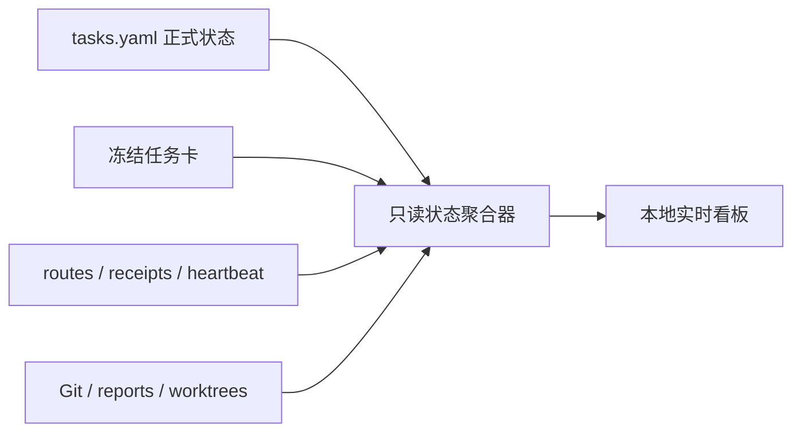

# 看板与可观测性规划

## 当前能力：可审计的 Markdown 快照

AgentDesk 当前已经生成：

- `docs/pm/BOARD.md`：按任务状态分组的人类视图；
- `docs/pm/STATUS.md`：项目控制、状态汇总和当前派发概览；
- `docs/pm/CONSULTATIONS.md`：在项目启用咨询控制面时，投影圆桌议题、席位覆盖、轮次、Owner 确认和派生状态。

它们由以下命令从 `tasks.yaml` 生成：

```bash
python3 -I <skill-dir>/scripts/render_views.py --project <repo>
```

这些文件是确定性快照，不是实时网页。它们不会持续观察岗位会话、Git 活动、callback receipt 或 heartbeat，也不会自行刷新。咨询投影在生成前会通过公开严格校验，但仍不代表宿主运行时会话真实存在。

## 规划能力：本地实时看板

实时看板应当增加一个只读观测层，而不是取代 `tasks.yaml`。



建议实现组件：

- `collect_status.py --json`：输出经过脱敏的状态投影；
- `serve_board.py`：只绑定 `127.0.0.1` 的只读本地服务；
- 1–2 秒轮询或 SSE 刷新；
- 可选本地 Markdown 视图供 Obsidian 使用；
- runtime 文件损坏时保留 last-good snapshot 并发出告警。

> 本页描述的是规划方案。当前公开 beta 尚未包含上述脚本或网页服务。

## 必须同时显示三类信息

### 正式状态

只来自 `docs/pm/state/tasks.yaml`，例如 `in_progress`、`review_ready`、`accepted`。

### 现场观测

来自 runtime、Git 和报告，例如：

- 岗位 route verified / stale；
- 派发 sent / acknowledged；
- report 是否已经生成；
- callback receipt 是否存在；
- worktree 和 Git 提交是否可读；
- PM lease / heartbeat 是否新鲜。

### 诊断与下一步

把两层事实进行对照，但不自动改状态：

```text
TC-002
正式状态：in_progress
岗位任务：已结束
交付报告：已生成
callback receipt：缺失
诊断：F05 丢回调
下一步：唤醒 PM 审查 artifact，并修复回调路由
```

## 让看板更有趣的方式

趣味性应来自“真实协作正在发生”，而不是金币、排行榜和虚假进度。

### 岗位舱

每个岗位显示规范名称、当前任务、最近有效事件、route 健康和等待对象。无法证明 Agent 当前活动时，只显示最近证据，不假装展示内部思考。

### 真实事件动画

只有实际事件触发短动画：

- 派发：任务卡从 Leader 移向岗位；
- ACK：岗位活动环闭合；
- Commit：增加代码工件；
- Report：增加报告附件；
- Callback：信号返回 Leader；
- Acceptance：出现验收印章；
- Integration：任务进入共享基线轨道；
- Blocked：线路出现带责任人的阻塞节点。

### 任务旅程

不用没有证据的完成百分比，改用可验证阶段：

```text
需求冻结 ✓ → 已派发 ✓ → 已接单 ✓ → 已交付 ✓
→ 已回调 ✕ → 已验收 — → 已集成 —
```

点击每一步查看 event、receipt、commit 或 acceptance。

### “刚刚发生了什么”

进入页面时根据事件账本和本地观测总结：

```text
自你上次查看后：
3 个任务发生变化
2 个岗位完成交付
1 个回调仍未送达
```

### 项目纪事与回放

按真实事件生成时间轴，允许回看一天内的派发、提交、回调、验收和集成过程。

## 推荐界面结构

```text
顶部：项目脉搏 / 活跃岗位 / 阻塞 / 待回调
左侧：动态任务流或 Kanban
右侧：岗位舱与 Leader 待办
底部：实时事件河流
点击任务：打开任务旅程和证据抽屉
```

视觉可以探索“指挥中心、协作星图、Agent 工作室”三种主题，但三种主题必须使用同一套真实状态投影。

## 看板不能做的事

- 不能成为第二个可变状态权威；
- 不能拖拽卡片后直接修改 `tasks.yaml`；
- 不能因为检测到 commit 或 report 就自动验收；
- 不能把 heartbeat 扫描冒充 Worker 主动回调；
- 不能展示 thread ID、绝对路径、provider receipt、凭据或内部推理；
- 不能用“在线”掩盖过期心跳；
- 不能显示没有可靠输入的完成百分比。

## 推荐实施顺序

1. 只读 JSON 状态聚合器；
2. 正式状态 / 现场观测 / 诊断三层投影；
3. 本地只读网页与自动刷新；
4. 岗位舱、事件动画和任务旅程；
5. heartbeat 与外部平台 adapter 接入；
6. 最后才考虑带审批的操作按钮。
